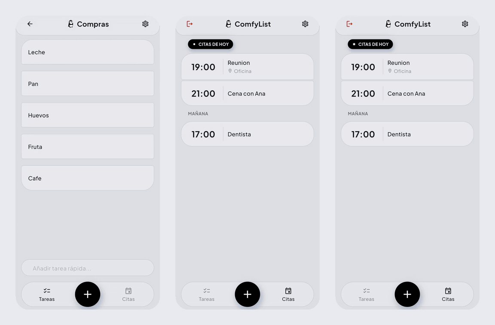

  

  
  
  
  
  

# ComfyList

App de TODOs y citas multiplataforma con sincronización vía Firebase. Tus listas, tareas y citas con recordatorios viven en tu cuenta y se cachean en el dispositivo para funcionar sin conexión, con una papelera en la nube que protege lo que borras.

  

## Características

- **Listas y tareas** con descripción y ubicación opcionales.
- **Citas con recordatorios**: hasta 5 márgenes de aviso por cita, configurables desde Ajustes.
- **Papelera en la nube**: cada borrado se guarda en tu cuenta (tope de 100), se restaura por grupos y puede vaciarse sola según el plazo que elijas.
- **Deshacer** al borrar, desde el propio aviso, con pantalla de Papelera para restaurar o vaciar.
- **Sincronización y offline**: todo se guarda en tu cuenta y se cachea en el dispositivo; la app arranca sin red.
- **Cuentas**: correo y contraseña con verificación por correo, y Google Sign-In (Android).
- **Notificaciones locales** para los recordatorios de citas.

## Estado

Android es la plataforma principal (fase 1). Web y escritorio están en camino; Google Sign-In, por ahora, solo en Android.

## ¿Quieres desarrollar?

Empieza por [`docs/development.md`](docs/development.md): requisitos, configuración de Firebase, comandos y flujo de releases.
